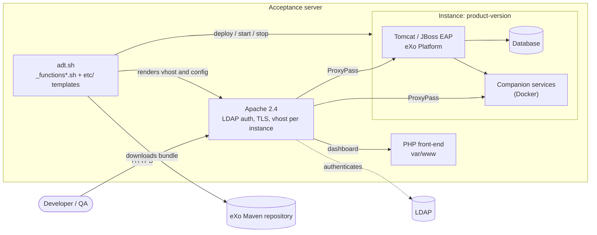
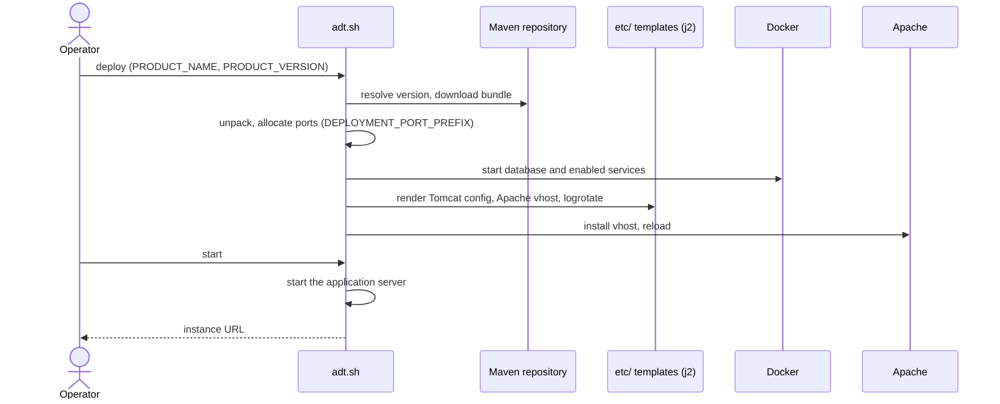
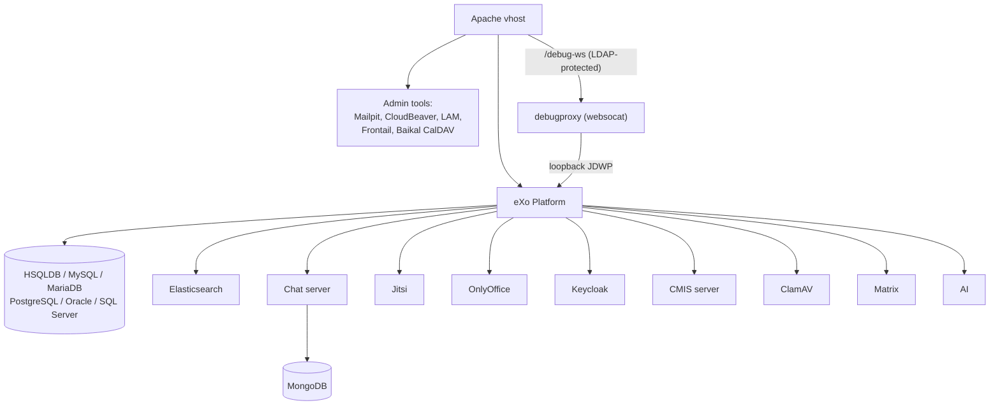
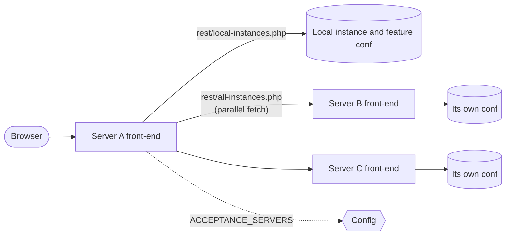

# ADT – Acceptance Deployment Tool

A set of Bash scripts, templates and a PHP front-end that deploy eXo products
(eXo Platform, Meeds, GateIn…) as throw-away instances for testing, demos and
acceptance. Each instance gets its own ports, database, Apache vhost and,
optionally, a set of companion services running in Docker.

## What it does

- **Deploy** a product bundle from the eXo Maven repository (release, snapshot,
  or a rolling `-MLT` / `-MBL` / `-GA` version), configure it and start it.
- **Databases**: HSQLDB, host MySQL, or Docker MySQL, MariaDB, PostgreSQL,
  Oracle and SQL Server.
- **Companion services**, enabled per instance with `DEPLOYMENT_*_ENABLED`:
  Elasticsearch, Chat (with MongoDB), CMIS, Jitsi, Keycloak, OnlyOffice, CalDAV
  (Baïkal), Matrix, Mailpit, ClamAV, CloudBeaver, LDAP Account Manager (LAM),
  Frontail (live logs), Iframely, AI, SFTP and Certbot (automatic TLS).
- **Reverse proxy**: one Apache vhost per instance, with LDAP authentication,
  optional HTTPS, per-instance Awstats and logrotate.
- **Remote debug** (JDWP) behind the authenticated vhost, with no exposed port.
- **Web front-end** (`var/www`): dashboard of instances across acceptance
  servers, features, Crowdin health, sales and company pages, instance
  editing and a `/debug` section for admins (health, config, caches, sessions,
  audit log, Apache logs…).

## Prerequisites

Mandatory:

- Bash, `curl`, `rsync`, `git`, `unzip`
- A JDK in the `PATH` that matches the product version you deploy
- Docker, used for databases and companion services, and for the `j2` template
  renderer when it is not installed on the host

Optional:

- Apache 2.4 with PHP 8 to serve the front-end and the instance reverse proxies
  (not needed with `ADT_DEV_MODE=true`)
- A local MySQL (`~/.my.cnf`) to use `DEPLOYMENT_DB_TYPE=MYSQL`
- UFW, which opens and closes the ports an instance needs
- Awstats, for usage statistics

## Quick start

```sh
git clone https://github.com/exoplatform/adt.git
cd adt

# Working directory used by ADT (downloads, servers, configuration…)
export ADT_DATA=$HOME/adt_data
```

Settings can also live in `$HOME/.adtrc` or `/etc/default/adt`.

```sh
export PRODUCT_NAME=plfcom PRODUCT_VERSION=7.2.0-MLT   # product and version

./adt.sh deploy      # download and configure
./adt.sh start       # start the instance
./adt.sh restart
./adt.sh stop
./adt.sh undeploy    # stop and delete it
./adt.sh list        # all deployed instances
```

Deploy several copies of the same product and version by setting `INSTANCE_ID`.
`PRODUCT_NAME` and `PRODUCT_VERSION` are read from the environment. To pass them
as options instead, use `adt-dev.sh`:

```sh
./adt-dev.sh deploy -n plfcom -v 7.2.0-MLT -p 200 -d DOCKER_POSTGRES:16
```

Other actions: `start-all`, `stop-all`, `restart-all`, `undeploy-all`,
`download-dataset`, `init`, `update-repos` and `web-server`.

### Try the front-end locally

```sh
./adt.sh web-server   # forces ADT_DEV_MODE=true and starts the PHP built-in server
```

In development mode Apache, Awstats and UFW are disabled and the front-end is
served on `http://localhost:8080`.

## Configuration

Every setting is an environment variable. The complete, current list (global
settings, products, database, mail, LDAP, Chat, Elasticsearch, Certbot…) is
printed by:

```sh
./adt.sh -h
```

The most useful ones:

| Variable | Purpose |
| --- | --- |
| `ADT_DATA` | Working directory (default: the script directory) |
| `ADT_DEV_MODE` | Local mode without Apache, Awstats or UFW |
| `ADT_OFFLINE` | Use local resources only |
| `ADT_SESSION_PASSPHRASE` | Secret that encrypts the front-end login cookie (required) |
| `PRODUCT_NAME` | `plf`, `plfcom`, `plfent`, `plfenteap`, `plftrial`, `plfdemo`, `meeds`, `gatein`, `exogtn`, `addonchat`, `compint`, `community`, `docs` |
| `PRODUCT_VERSION` | Release, `-SNAPSHOT`, or `-MLT` / `-MBL` / `-GA` (with optional `Z` wildcard, e.g. `7.2.Z-GA`) |
| `INSTANCE_ID` | Distinguishes several deployments of the same product and version |
| `DEPLOYMENT_DB_TYPE` | `HSQLDB`, `MYSQL`, `DOCKER_MYSQL`, `DOCKER_POSTGRES`, `DOCKER_MARIADB`, `DOCKER_ORACLE`, `DOCKER_SQLSERVER` |
| `DEPLOYMENT_MODE` | `NO_DATA`, `KEEP_DATA`, `RESTORE_DATASET` or `DUMP_DATASET` |
| `DEPLOYMENT_ADDONS` | Add-ons installed with the eXo add-ons manager |
| `DEPLOYMENT_APACHE_SECURITY` | `private` (LDAP login) or `public` |
| `DEPLOYMENT_APACHE_HTTPS_ENABLED` | Add an HTTPS vhost |
| `LDAP_ACCEPTANCE_*` | LDAP bind and admin group used by the front-end |

## Remote debug of an instance

The JDWP port has no authentication or encryption, so it is **not** exposed.
With `DEPLOYMENT_DEBUG_ENABLED=true` it listens on the server loopback only and
is reachable through `https://<instance-host>/debug-ws`, protected by the
vhost LDAP authentication. A small `websocat` container
(`<instance>_debugproxy`, see `_functions_debugproxy.sh`) adapts WebSocket to
JDWP.

Developers do not need this repository. The front-end shows the setup steps
(websocat, IntelliJ, Eclipse, troubleshooting) in a dialog opened from the
instance's debug badge, and serves the helper script on `/adt-debug.sh`.

`DEPLOYMENT_DEBUG_EXPOSE_PORT=true` exposes JDWP on all interfaces and in the
firewall, **without any authentication**: anyone who can reach it can run code
in the instance. Avoid it.

## Architecture

### Overview



### Deploying an instance



### Companion services of an instance



### Front-end and multi-server aggregation



## Repository layout

| Path | Content |
| --- | --- |
| `adt.sh`, `adt-dev.sh` | Entry points |
| `_functions*.sh` | Core logic, one file per area (`_functions_tomcat.sh`, `_functions_database.sh`, `_functions_keycloak.sh`…) |
| `etc/` | Jinja2 templates: Apache, Tomcat, JBoss EAP, Keycloak, Matrix, OnlyOffice, logrotate… |
| `var/www/` | PHP front-end and debug pages |
| `dev/login-test/` | Docker Compose stack (OpenLDAP + Apache) to try the front-end login locally |
| `integration-tests.sh` | Integration tests |

## Contributing

CI keeps the pinned Docker image versions (CloudBeaver, Frontail, Mailpit) and
GitHub Actions up to date through auto-bump workflows and Dependabot. Commit
messages follow [Conventional Commits](https://www.conventionalcommits.org/).
