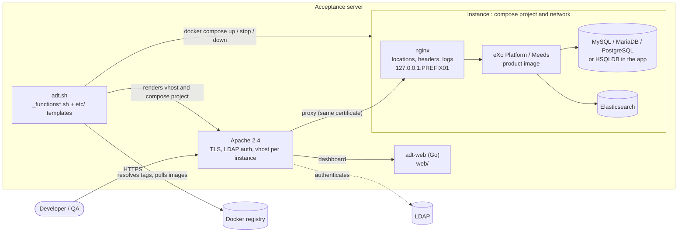
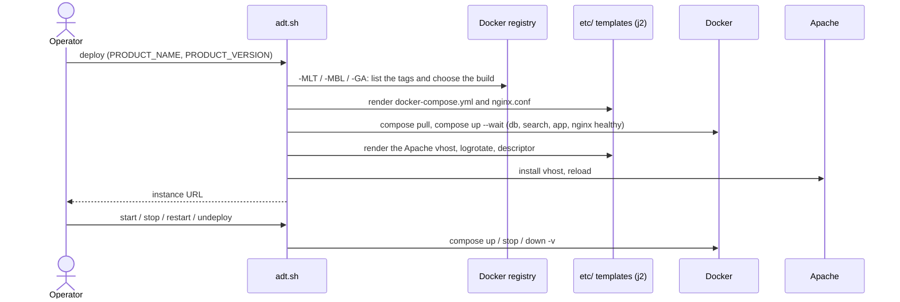
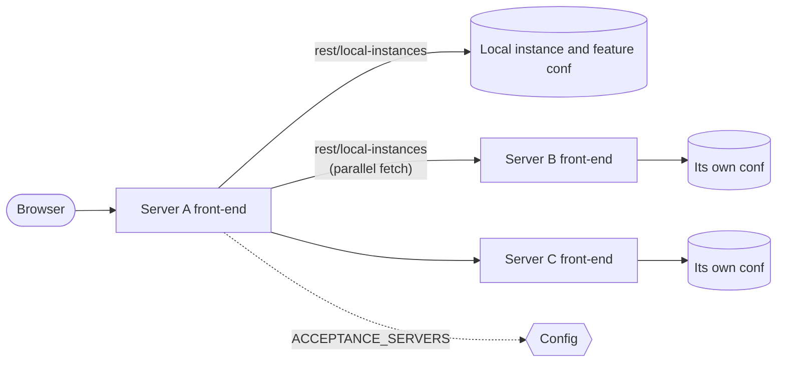

# ADT – Acceptance Deployment Tool

A set of Bash scripts, templates and a Go front-end (`adt-web`) that deploy eXo products
(eXo Platform and Meeds 7.0 and later) as throw-away instances for testing, demos and
acceptance. Each instance is a Docker Compose project on its own network, made of the
product image, its database, Elasticsearch and an nginx reverse proxy, behind an Apache
virtual host.

## What it does

- **Deploy** the Docker image of a product: `meedsio/meeds`, `exoplatform/exo-community`
  or `exoplatform/exo-enterprise`. The version is the tag of the image: a release
  (`7.2.2`), a snapshot (`7.3.x-SNAPSHOT`), or a build chosen in the registry with a
  rolling `-MLT` / `-MBL` / `-GA` version (see `_functions_registry.sh`).
- **Databases**: HSQLDB (in the application), or a MySQL, MariaDB or PostgreSQL container.
  The versions of the database, Elasticsearch and jdbc drivers follow the minor version of the product
  (7.0, 7.1, 7.2, 7.3), see `initialize_product_settings` in `_functions.sh`.
- **Isolation**: one network per instance, named after the instance key (`plfent-7.3.0-M16`), as are its
  containers (`<key>_exo`, `_db`, `_search`, `_web`) and volumes. The only published port is the one of
  its nginx, on `127.0.0.1:<DEPLOYMENT_PORT_PREFIX>01`. The data live in docker volumes.
- **Reverse proxies**: nginx (per instance) owns the locations, the security headers, the compression and
  the logs. Apache (one vhost per instance) terminates the TLS, authenticates with LDAP and forwards to
  that nginx; with HTTPS enabled both serve the same certificate, from the domain or from Certbot.
- **Companion services** (Jitsi, Keycloak, OnlyOffice, CalDAV, Matrix, Mailpit, ClamAV, CloudBeaver, LAM,
  Frontail, Iframely, AI, SFTP, remote debug) are being moved into the compose project: enabling one is
  refused for now.
- **Web front-end** (`web/`, Go): dashboard of instances across acceptance
  servers, features, Crowdin health, sales and company pages, instance
  editing and a `/debug` section for admins (health, config, caches, sessions,
  audit log, Apache logs…).

## Prerequisites

Mandatory:

- Bash, `curl`, `jq`, `rsync`, `git`
- Docker with the compose plugin (v2), used for every instance and for the `j2` template
  renderer when it is not installed on the host. The user running ADT must be allowed to use it (`docker` group);
  it does not need to be root: the data live in docker volumes and nothing is `chown`ed.
- Room for the instances: about 2.5 GB of RAM for a small one (application 1 GB heap, Elasticsearch, database)

Optional:

- Apache 2.4 to authenticate and proxy the front-end and to reverse-proxy the instances
  (not needed with `ADT_DEV_MODE=true`, where nginx is published directly without TLS)
- Go 1.26 **or** Docker, to build the front-end (`./adt.sh build-web`); the hosts need no Go toolchain
  because the build falls back to a `golang` container
- UFW, which opens and closes the ports an instance needs
- Awstats, for usage statistics

Docker gives every network a subnet from its address pools: with the default ones about 30 instances fit on a
host (`adt.sh deploy` checks it and tells how to widen the pools in `/etc/docker/daemon.json`).

## Quick start

```sh
git clone https://github.com/exoplatform/adt.git
cd adt

# Working directory used by ADT (downloads, servers, configuration…)
export ADT_DATA=$HOME/adt_data
```

Settings can also live in `$HOME/.adtrc` or `/etc/default/adt`.

```sh
export PRODUCT_NAME=plfcom PRODUCT_VERSION=7.2.0-MLT   # product and version

./adt.sh deploy      # pull the images and configure
./adt.sh start       # start the instance
./adt.sh restart
./adt.sh stop
./adt.sh undeploy    # stop and delete it
./adt.sh list        # all deployed instances
```

Deploy several copies of the same product and version by setting `INSTANCE_ID`.
`PRODUCT_NAME` and `PRODUCT_VERSION` are read from the environment. To pass them
as options instead, use `adt-dev.sh`:

```sh
./adt-dev.sh deploy -n plfcom -v 7.2.0-MLT -p 200 -d POSTGRES:17
```

Other actions: `start-all`, `stop-all`, `restart-all`, `undeploy-all`,
`init`, `update-repos`, `build-web`, `deploy-web` and `web-server`.

### Try the front-end locally

```sh
./adt.sh web-server   # builds adt-web, forces ADT_DEV_MODE=true and runs it in the foreground
```

In development mode Apache, Awstats and UFW are disabled and the front-end is
served on `http://localhost:8080` with a fake identity (`ADT_DEV_USER`, `ADT_DEV_NAME`,
`ADT_DEV_MAIL`).

### Front-end deployment (`adt-web`)

`adt.sh init` deploys the dashboard in four steps, all driven by the same ADT variables as the Apache
vhost (the environment of the user running it, `/etc/default/adt`, `~/.adtrc`):

1. builds `${ADT_WEB_BIN}` (default `${ADT_DATA}/bin/adt-web`) from `web/`, with the local Go when it is
   recent enough, otherwise in a `golang` container pinned by digest (`ADT_WEB_GO_IMAGE` overrides it; bump
   the digest in `_functions_web.sh` with the Go patch releases); nothing is rebuilt when the sources did not
   change;
2. renders the service environment file `${ADT_WEB_ENV_FILE}` from `etc/adt-web/adt-web.env.j2`
   (`ACCEPTANCE_HOST`, `ACCEPTANCE_SERVERS`, the socket, `ADT_WEB_CSP`...);
3. restarts the `${ADT_WEB_SERVICE}` systemd service (`sudo service adt-web restart`) when the binary or
   that file changed, and waits until it answers on `${ADT_WEB_SOCKET}`;
4. reloads Apache, whose vhost (`etc/apache2/includes/frontend.include.j2`) keeps doing the LDAP login and
   hands the verified identity to `adt-web` through request headers over that unix socket.

The systemd unit and the sudo rule are provisioned outside this repository. `adt.sh build-web` and
`adt.sh deploy-web` run the steps on their own.

Each server serves its own instances (`/rest/local-instances`) and the dashboard merges the answers of every
server of `ACCEPTANCE_SERVERS`. The pages show the host the visitor used; what a server publishes (instance
links, the host the edit forms post to) is built from its own `ACCEPTANCE_HOST`, never from the `Host` header.

The pages carry no inline script or event handler: the scripts are the files of `web/static/js`, and the pages are
served with a Content-Security-Policy that only allows scripts from the dashboard itself and the CDNs it uses.
`ADT_WEB_CSP` sets it to `enforce` (default), `report-only` (the browser only logs what it would block, useful to
try a change) or `off`.

## Configuration

Every setting is an environment variable. The complete, current list (global
settings, products, database, Elasticsearch, Certbot…) is
printed by:

```sh
./adt.sh -h
```

The most useful ones:

| Variable | Purpose |
| --- | --- |
| `ADT_DATA` | Working directory (default: the script directory) |
| `ADT_DEV_MODE` | Local mode without Apache, Awstats or UFW |
| `ADT_OFFLINE` | Use local resources only |
| `ADT_SESSION_PASSPHRASE` | Secret that encrypts the front-end login cookie (required) |
| `ACCEPTANCE_HOST` | Name of this server (its Apache virtual host); the front-end publishes it for the other servers |
| `ACCEPTANCE_SERVERS` | Base URLs of every acceptance server, this one included. List live servers only: a page that merges the servers waits for an entry that does not answer |
| `ADT_ADMIN_USERS` | Comma-separated logins of the dashboard administrators: only they get the control that changes the base branch of a feature branch on `/features` (Apache also limits `POST /editFeatureBase` to the LDAP admin group). Empty: nobody, in development mode everybody |
| `PRODUCT_NAME` | `meeds`, `plfcom` or `plfent` (versions 7.0 and later) |
| `PRODUCT_VERSION` | The tag of the image: a release, `-SNAPSHOT`, or `-MLT` / `-MBL` / `-GA` resolved in the registry (with optional `Z` wildcard, e.g. `7.2.Z-GA`) |
| `INSTANCE_ID` | Distinguishes several deployments of the same product and version |
| `DEPLOYMENT_DB_TYPE` | `HSQLDB`, `MYSQL`, `MARIADB` or `POSTGRES` (the former `DOCKER_*` names are accepted) |
| `DEPLOYMENT_MODE` | `NO_DATA` (default for deploy) or `KEEP_DATA` (default for restart); the datasets (`RESTORE_DATASET`, `DUMP_DATASET`) are being ported |
| `DEPLOYMENT_ADDONS` | Add-ons installed by the add-ons manager of the image |
| `DEPLOYMENT_PORT_PREFIX` | Port slot of the instance: its nginx listens on `127.0.0.1:<prefix>01` |
| `DEPLOYMENT_APACHE_SECURITY` | `private` (LDAP login) or `public` |
| `DEPLOYMENT_APACHE_HTTPS_ENABLED` | Add an HTTPS vhost; nginx then serves the same certificate |
| `LDAP_ACCEPTANCE_*` | LDAP bind and admin group used by the front-end |

## Remote debug of an instance

The remote debug (JDWP behind the authenticated vhost, through a WebSocket adapter) is one of the companion
services that are being moved into the compose project, `DEPLOYMENT_DEBUG_ENABLED=true` is refused for now.
The JDWP port itself is never published: the debug will only be reachable through nginx at `/debug-ws`, protected by
the LDAP authentication of the vhost.

## Architecture

### Overview



### Deploying an instance



### Front-end and multi-server aggregation



## Repository layout

| Path | Content |
| --- | --- |
| `adt.sh`, `adt-dev.sh` | Entry points |
| `_functions*.sh` | Core logic, one file per area (`_functions_compose.sh`, `_functions_registry.sh`, `_functions_apache.sh`…) |
| `etc/` | Jinja2 templates: compose project and nginx (`etc/compose/`), Apache, instance descriptor, logrotate… |
| `web/` | The Go front-end `adt-web`: pages, `/rest/*` API, static files |
| `tests/` | Tests of the tag resolution and of the compose templates (`tests/registry_test.sh`, `tests/compose_templates_test.sh`) |
| `integration-tests.sh` | Deploys instances for real |

## Contributing

CI keeps the pinned Docker image versions (CloudBeaver, Frontail, Mailpit) and
GitHub Actions up to date through auto-bump workflows and Dependabot. Commit
messages follow [Conventional Commits](https://www.conventionalcommits.org/).
